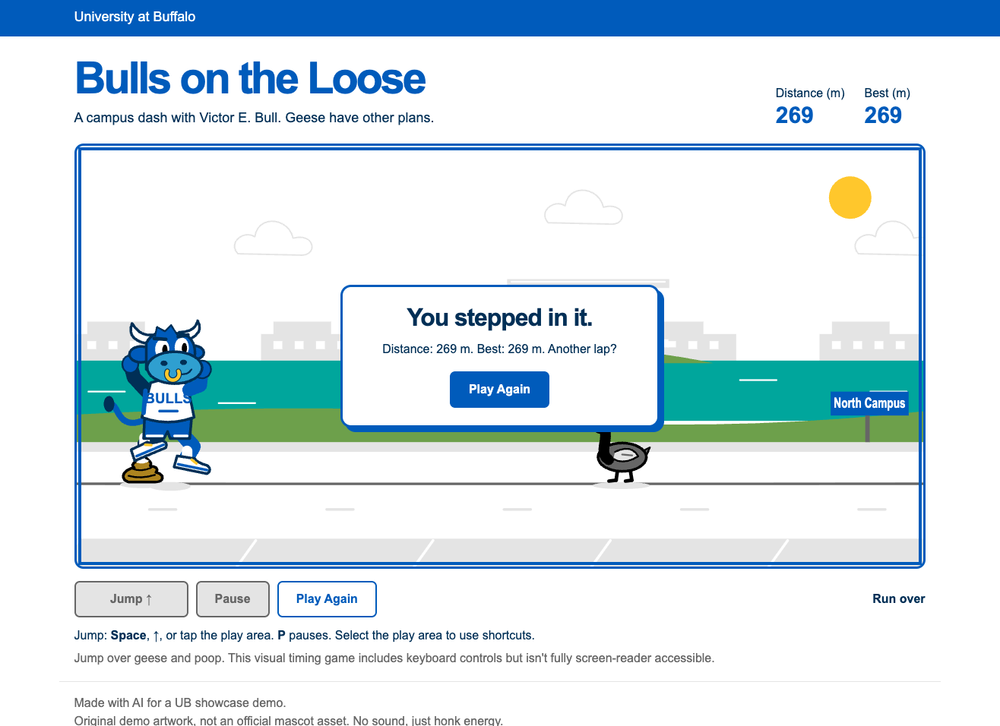

# UB AI Showcase demos

Small browser games for the AI for Developers table. Each one has a reusable prompt that works as a complete build brief. Copy the whole file into a coding assistant and run it in an empty working folder. It asks the assistant to create `game/index.html`, which opens directly in a browser and works offline once generated.

Running a prompt again should recreate the same concept and features. Artwork, code, and difficulty will vary between runs.

| Demo | Style | Prompt |
|---|---|---|
| [Bulls on the Loose](#bulls-on-the-loose) | Endless runner | [bulls-on-the-loose.txt](prompts/bulls-on-the-loose.txt) |
| [Cross the Loop](#cross-the-loop) | Lane-crossing arcade | [cross-the-loop.txt](prompts/cross-the-loop.txt) |

## Bulls on the Loose

A colorful browser runner. Victor E. Bull tries to cross campus by jumping over Canada geese and poop, and ducking under flying geese. Short rounds and quick restarts let visitors take turns at the table.

### Sample result

One generated version, shown as an example. The screenshot isn't required to use the prompt.

### First version

- Tap for a low hop, hold for a higher jump, and hold Down Arrow to duck. Ground geese, poop, and low-flying geese are the hazards.
- Original drawn mascot and scenery, with UB blue and white leading the design.
- Gradually increasing speed, distance score, and a best score saved in the visitor's browser.
- Keyboard and touch controls, pause, and a fast restart.
- One HTML file with no installs or runtime network access.

Keep sound and power-ups out of the first build. They're useful changes to demonstrate once the basic game works.

### Follow-up prompts

> Add an Easy mode with a slower speed cap and wider obstacle spacing. Keep the existing mode. Let players choose before starting, and track a separate best score for each mode.

> Add an optional synthesized honk when a goose ends a run. Include a labeled sound toggle, default it off, and only initialize audio after a user gesture. Keep the game self-contained and playable offline.

> Add a "Goose patrol" practice mode. Show the collision boxes and allow a slower game speed so we can see how jumping and collisions work. Keep practice scores out of the best-score record.

## Cross the Loop

A top-down lane-crossing game. A student late for class has to get from the Flint Loop bus stop to the lecture hall, dodging Stampede buses, cars circling for parking, students on e-scooters, geese that won't yield, low-flying geese that drop poop from above, and the goose poop that covers every lawn. Each hit gets its own joke ("HONK! The goose has tenure."), and levels run from Syllabus Week to Finals Week.

### First version

- Arrow keys, WASD, swipe, or an on-screen D-pad move one square at a time.
- Buses, cars, bikes, students on e-scooters, wandering geese, and goose poop on the ground, each drawn so they're easy to tell apart.
- From level 2, geese swoop in low across a row and drop poop. Warning arrows and target rings make them dodgeable.
- Every board cleared makes lanes a little faster and adds more scooters, flyovers, and poop, up to a cap.
- A 30-second "Class starts in" timer, 3 lives shown as coffee cups, and five named levels from Syllabus Week to Finals Week.
- Random hit, success, and game-over lines so repeat plays stay fresh.
- Score for progress, reaching class, and time left, plus a best score saved in the visitor's browser.
- One HTML file with no installs or runtime network access.

The message lists and tuning values sit near the top of the file. Visitors can suggest their own jokes or hazards and see them added live.

### Follow-up prompts

> Add a new hazard: slush puddles on some road rows that make the student slide one extra square in the direction they moved. Show them clearly and keep every row crossable.

> Add a hit message suggested by a visitor: "[visitor's line]". Use it for [hazard]. Keep the existing messages.

> Add an optional synthesized honk for goose hits and a bus horn for Stampede hits. Include a labeled sound toggle, default it off, and only initialize audio after a user gesture. Keep the game self-contained and playable offline.

> Replace the student with Victor E. Bull, drawn top-down with blue fur, white horns, and a gold nose ring. Keep the same size and hitbox.

## Table demo plan

Works the same for either game.

1. Before the event, run the prompt in a fresh folder. Play the result on a laptop and phone-sized viewport, and check that it works offline. Save a known-good copy separately as a fallback.
2. At the table, show the prompt and explain the goal: describe a small game, let AI build it, then test what it made. Start a fresh generation while visitors play the saved copy. Generation time will vary.
3. Open the new game and let a visitor try a round. Show how you check the controls, collisions, and difficulty instead of assuming the generated code works.
4. Ask the visitor for one change. Apply it, reload, and try it together. Keep the original copy available for the next visitor.

Use a separate folder per game. Both prompts write to `game/index.html`.

## Reference notes

- The [UB AI Showcase announcement](https://www.buffalo.edu/ubit/news/article.host.html/content/shared/www/ubit/news/2026/ubit-new-AI-Showcase.detail.html) lists November 4, 2026, 10 a.m. to 3 p.m., in the Student Union, with drop-in demonstrations including AI for Developers.
- UB identifies its blue bull mascot as [Victor E. Bull](https://www.buffalo.edu/trueblue/our-stories.host.html/content/shared/www/trueblue/articles/victor-history.detail.html).
- Colors follow the [UB palette](https://www.buffalo.edu/brand/creative/color/color-palette.html), including UB Blue `#005bbb` and white `#ffffff`.
- Flint Loop is a North Campus stop on the [UB Stampede bus routes](https://www.buffalo.edu/parking/getting-around-UB/bus.html). It [closed temporarily in May 2026](https://www.buffalo.edu/campusliving/about-us/announcements.host.html/content/shared/www/parking/advisories/2025-26/flint-loop-temporarily-closed-may-2026.detail.html) after a water main break. The [fall 2026 schedule](https://www.buffalo.edu/parking/getting-around-UB/bus/bus-schedules/fall-semester.html) lists Flint Loop again.
- The campus goose problem and the parking jokes are the premise for the humor, not measured claims. The prompts use the species name "Canada geese."

Bulls on the Loose references checked October 30, 2026. Flint Loop and Stampede references checked November 2, 2026.
